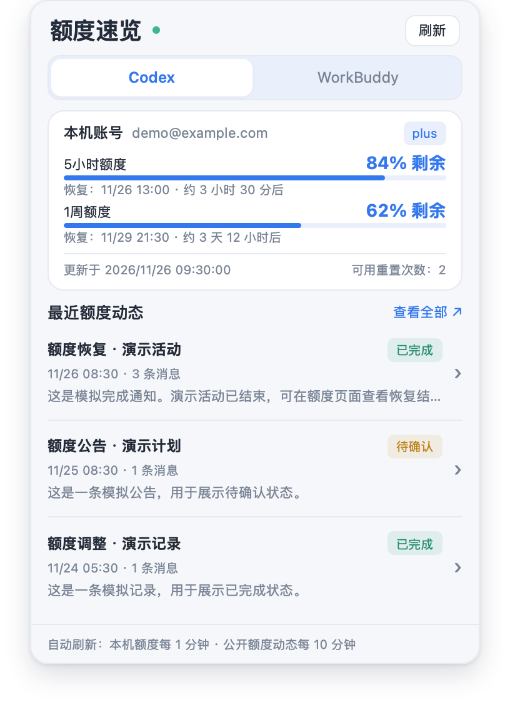
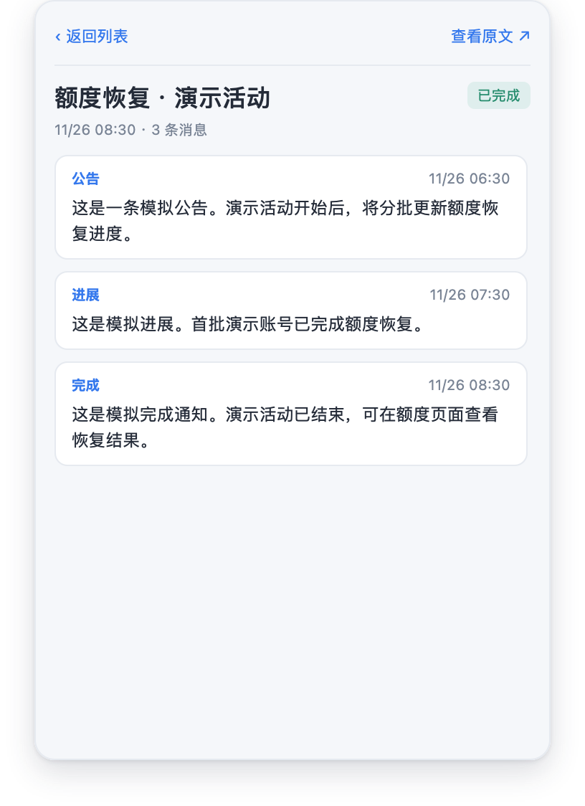
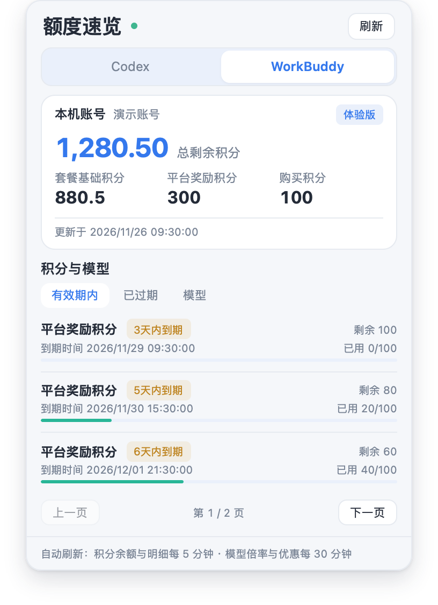
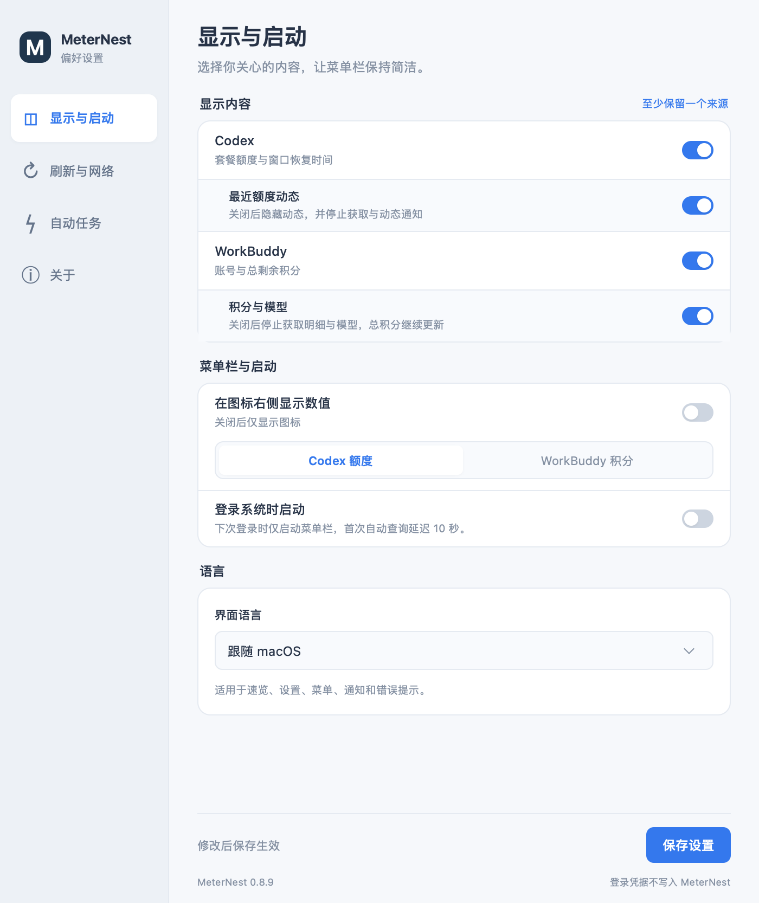
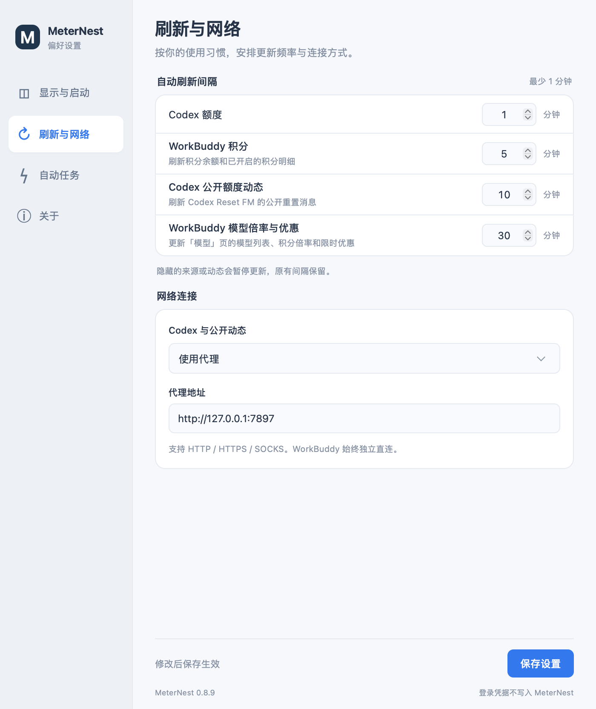
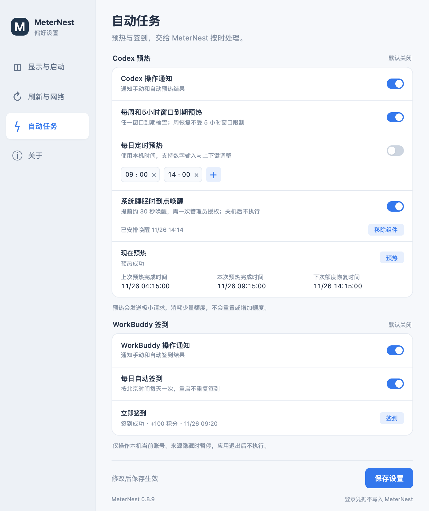
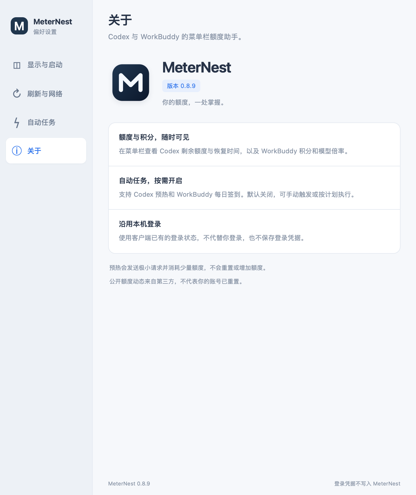

<p align="center"></p>

# MeterNest

MeterNest 是一款 macOS 菜单栏应用，用来查看本机 Codex 账号的剩余额度，以及 WorkBuddy 账号的积分和模型倍率。打开菜单栏里的 M 图标即可查看详情，也可以把常看的数值直接放在图标旁边。

## 界面预览

截图通过当前界面渲染。账号、额度、积分、公开动态和任务记录均为测试数据。

### 菜单栏速览

| Codex 额度速览 | 动态详情 | WorkBuddy 积分速览 |
| --- | --- | --- |
|  |  |  |

### 设置窗口

| 显示与启动 | 刷新与网络 |
| --- | --- |
| <a href="docs/previews/display-startup.png"></a> | <a href="docs/previews/refresh-network.png"></a> |

| 自动任务 | 关于 |
| --- | --- |
| <a href="docs/previews/automation.png"></a> | <a href="docs/previews/about.png"></a> |

## 安装与使用

MeterNest 支持 **macOS 13 及以上、Apple 芯片（arm64）**。可以按下文的打包步骤生成 DMG。

1. 打开本地 `release/` 目录中对应版本的 `MeterNest_<版本>_aarch64.dmg`。
2. 将 `MeterNest.app` 拖入「应用程序」，再从「应用程序」启动。
3. 安装完成后，在 Finder 中推出安装镜像。

MeterNest 启动后常驻菜单栏。点击 M 图标打开额度速览，再次点击或按 Esc 收起。右键图标可以刷新数据、进入设置或退出应用。关闭设置窗口后，MeterNest 继续在后台运行。

## 额度速览

| 来源 | 可查看的信息 |
| --- | --- |
| Codex | 本机账号、套餐、各额度窗口的剩余比例与恢复时间，以及可用重置次数（若客户端提供）。 |
| WorkBuddy | 本机账号、总剩余积分、套餐基础积分、平台奖励、购买积分，以及资源包明细和模型倍率。 |
| 公开额度动态 | 查询近期公开额度动态。已跟踪的重置动态从待确认变为完成时，可发送 macOS 通知。 |

WorkBuddy 的「有效期内」明细优先展示还有余额的积分，同组内按到期时间从近到远排序。已用完但仍在有效期内的记录排在后面，也可另查看「已过期」明细。「模型」页展示积分倍率和限时优惠。

Codex 查询需要本机已安装并登录 Codex 客户端或 CLI。WorkBuddy 沿用本机客户端的登录状态，优先通过已安装客户端的运行时查询。使用本机通信接口回退时，需要 WorkBuddy 正在运行。第三方公开动态仅供参考，不能用于判断个人账号是否已重置。

## 设置

| 页面 | 主要选项 |
| --- | --- |
| 显示与启动 | Codex 与 WorkBuddy 默认都显示，至少保留一个。可独立控制公开动态和 WorkBuddy 积分与模型明细。登录时启动和图标旁数值默认关闭。 |
| 刷新与网络 | 默认每 1 分钟刷新 Codex 额度，每 5 分钟刷新 WorkBuddy 积分，每 10 分钟刷新公开动态和模型配置。四个周期可以分别调整。 |
| 自动任务 | 管理 Codex 预热、WorkBuddy 签到和系统唤醒，也可以手动触发预热或签到。 |

「刷新与网络」默认选择代理模式，预填地址为 `http://127.0.0.1:7897`。可按本机环境选择代理或直连。设置支持 HTTP、HTTPS、SOCKS4 和 SOCKS5 地址。WorkBuddy 使用独立的连接方式，Codex 预热访问本机回环地址时始终直连。

### 自动任务

预热、签到和系统唤醒的自动开关默认关闭。

- **Codex 预热**支持手动执行、在每日指定的本机时间执行，以及在 5 小时或每周额度窗口到期时检查。预热会发出一个很小的模型请求并消耗少量额度，不会增加或重置额度。
- **WorkBuddy 签到**支持手动执行或按北京时间每日执行，签到记录按账号保存。
- **系统唤醒**可配合 Codex 预热计划，在电脑睡眠时尝试提前约 30 秒唤醒。定时唤醒系统后等待 30 秒，再重新检查账号和额度。Mac 已醒时立即检查，屏幕熄灭时也可执行。此功能需在正式安装的应用中授权组件，关机后不执行。

来源隐藏时，相应的自动任务会暂停。应用退出后，自动任务停止执行。

每日定时使用本机时区，WorkBuddy 每日签到按北京时间划分日期。5 小时或每周窗口到期预热按服务返回的窗口判断，其他窗口仍可独立配置每日定时预热。预热结果未确认时保留状态，避免自动重发造成重复消耗；账号切换后，旧请求的结果只归入原账号记录。

设置页按账号缓存三个时间。MeterNest 预热请求成功完成，或读到客户端对话开启的已使用 5 小时窗口时，原「本次预热完成时间」移到「上次」，新记录写入「本次」，「下次额度恢复时间」取当时 5 小时和 1 周额度窗口中最近的未来恢复时间。额度尚未读到时，恢复时间由下一次查询补齐。客户端窗口的开始时间用其恢复时间减去 5 小时推算，同一窗口重复刷新只记一次。三个时间在应用重启后保留，等下一次完成记录再轮转。实际任务按设置和额度窗口调度。

## 本地数据

MeterNest 使用客户端已有的登录状态。额度、积分和模型查询为只读，预热和签到会联系相应服务执行操作。应用配置不保存登录凭据。

偏好设置、公开动态缓存、通知记录和自动任务记录保存在 `~/Library/Application Support/MeterNest/meternest.json`。自动任务历史使用账号指纹区分记录。系统唤醒的计划文件是同一目录下的 `wake-plan.json`。

应用标识为 `com.meternest.desktop`，npm 包名为 `meternest`，应用名称为 `MeterNest`。修改设置通过设置界面保存。配置读取或备份失败时应保留原文件并提示错误，写盘成功后才更新内存状态；排查问题时避免在应用运行期间手动覆盖配置。

## 开发与打包

在 macOS 上开发需要 Node.js 24 或以上、npm、Rust stable 和 Xcode Command Line Tools。使用 nvm 时，先切换到相应的 Node.js 版本。

```sh
source ~/.nvm/nvm.sh
nvm ls
nvm use node
node --version  # 确认主版本 >= 24
npm ci --include=dev
npm run check
npm run dev
```

优先复用本机 nvm 已安装且满足 `>= 24` 的版本，无需固定次版本或补丁版本。`npm ci` 按锁文件安装依赖，新增或升级依赖时再使用 `npm install` 并同步锁文件。Rust 依赖由 `src-tauri/Cargo.lock` 锁定，macOS 唤醒组件在构建时由 `clang++` 编译。

本机依赖下载使用 `http://127.0.0.1:7897` 代理，需要联网安装 npm 或 Cargo 依赖时可在当前终端设置以下变量。其他机器按可用网络配置调整。

```sh
export HTTP_PROXY=http://127.0.0.1:7897
export HTTPS_PROXY=http://127.0.0.1:7897
export http_proxy=http://127.0.0.1:7897
export https_proxy=http://127.0.0.1:7897
```

这些变量用于开发命令。应用内的代理选项由「刷新与网络」页面单独管理。

| 命令 | 用途 |
| --- | --- |
| `npm run check` | 检查 Rust 代码能否编译。 |
| `npm run dev` | 启动开发版应用。 |
| `npm run build:mac` | 递增版本并打包 macOS DMG，在 Apple 芯片 Mac 上生成 arm64 安装包。 |
| `npm run build` | 沿用当前版本重新打包。 |

### 检查与回归

`npm run check` 只执行 Rust 编译检查，回归测试单独运行。

```sh
cargo test --manifest-path src-tauri/Cargo.toml
node --check ui/codex-monitor/panel.js
node --check ui/settings/renderer.js
```

按修改范围选择验证。网络修改检查实际路由、超时和回环直连；自动任务修改检查去重、重试、账号切换与取消；存储修改检查失败后原数据仍可用；界面修改检查深浅主题、紧凑模式、页签切换及窗口边缘。测试优先使用本机服务、临时目录和模拟数据，涉及真实预热、签到或唤醒的操作按用户授权执行。

报告中分别说明编译检查、回归测试、模拟环境与安装后实机验证。纯文档修改核对链接、命令和代码事实即可。目前项目没有配置 CI 工作流，检查以本机执行结果为准。

### 正式打包与版本

发布时运行 `npm run build:mac`。打包跳过会自动打开 Finder 的脚本，通过内置布局模板静默设置 DMG 的 660 × 400 窗口、100 px 图标和左右安装位置，生成的 DMG 会复制到 本地 `release/` 目录。日常修改只运行必要的检查，按明确的发布或打包请求生成安装包。

版本以 `package.json` 为准，递增脚本同时更新 npm 锁文件、应用配置和 Cargo 清单。次版本号和修订号按十进制进位，例如 `0.2.9` 递增到 `0.3.0`。若打包失败，可修正问题后用 `npm run build` 重试同一版本。

当前构建使用 ad-hoc 签名，尚未配置 Developer ID 和 Apple 公证。

正式流程为版本递增、编译、应用签名、DMG 生成、安装包图标处理及复制到 `release/`。打包脚本不自动执行回归测试，打包前按改动范围完成必要检查。macOS 安装包须在 macOS 上生成，当前交付目标为 Apple 芯片 arm64。

布局模板位于 `scripts/assets/dmg-layout.dsstore`，由 `scripts/set-dmg-layout.js` 写入临时可写镜像，再转换成压缩镜像。日常打包直接复用模板；调整布局时可在临时 Python 环境安装 `ds-store==1.3.1`，运行 `scripts/create-dmg-layout.py` 重新生成模板。模板只包含窗口和图标设置，不包含用户目录或磁盘别名。

`npm run build:mac` 每次递增一次版本，`npm run build` 沿用当前版本；`npm run version:bump` 是会修改版本的独立命令。递增会同步 `package.json`、`package-lock.json`、`src-tauri/tauri.conf.json` 与 `src-tauri/Cargo.toml`，Cargo 锁文件在后续构建中同步。开发、检查和测试不递增版本，打包失败后已递增的版本不自动回滚。

`hdiutil` 创建设备受执行环境权限限制时，按当前环境的授权流程重试原打包目标。交付时提供实际版本、平台、安装包绝对路径链接和已完成的验证。历史安装包与构建目录的清理范围应按用户要求确定。

### 打包完成后的展示格式

打包完成后，记录以下信息。

- 平台、架构与版本变化，例如「macOS ARM64 打包完成，版本 0.6.3 → 0.6.4」。沿用版本重新打包时写明实际版本。
- 本次安装包包含的调整，按用户可感知的功能或修复列出要点，结合上次交付后的实际变更整理。
- 与此次构建有关的结果，简要说明实际完成的检查、签名或依赖复用情况。只引用本次日志和已确认结果，保留重要的未验证范围。
- 安装包链接，使用实际文件名作为链接文字，并链接到本机安装包绝对路径。

MeterNest 的构建信息按自身工具链填写。依赖复用、下载情况和检查数量有实际依据时再写入交付说明。

### 目录

| 路径 | 内容 |
| --- | --- |
| [ui](ui/) | 额度速览、悬停提示和设置界面。 |
| [src-tauri/src](src-tauri/src/) | 应用入口、菜单栏与窗口、数据查询和自动任务。 |
| [src-tauri/resources/workbuddy](src-tauri/resources/workbuddy/) | WorkBuddy 本机查询和签到所需的资源。 |
| [src-tauri/wake-helper.mm](src-tauri/wake-helper.mm) | macOS 唤醒组件。 |
| [scripts](scripts/) | 版本号更新和 DMG 图标处理。 |

## 维护与 Agent 接手约定

1. **先核对当前要求和实现。** 阅读本文，按需查看相关源码和测试。存在适用的 `AGENTS.md` 时同时遵守。用户当前要求优先于历史记录，功能行为以当前代码为依据。
2. **保留现有功能与用户修改。** 按任务范围修改，优先复用现有查询、调度和存储逻辑。保持账号、额度、积分、模型、通知和菜单栏交互兼容。界面调整同时考虑深浅主题、紧凑模式与多屏定位。
3. **使用既有环境。** 复用本机合格的 Node.js、Rust 工具链和已安装依赖。联网操作使用本机可用代理，避免通过修改系统网络、登录状态或代理软件来替代应用修复。
4. **按范围验证并如实交付。** 为确认的缺陷选择能捕获回归的测试。已有充分证据后结束检查，说明实际通过的项目及尚未验证的范围。编译通过与安装后功能验证分别记录。
5. **按授权打包。** 日常修改和文档维护不触发安装包生成或版本递增。用户明确要求打包时执行既定脚本，保留跳过 Finder 安装窗口的行为和现有签名设置。失败重试使用 `npm run build` 沿用版本。
6. **保护真实用户数据。** 诊断日志避免包含令牌、密码、认证头和模型回复。保持查询只读、自动任务默认关闭及预热地址校验，保留本机回环直连、账号隔离和结果未确认时避免重发的行为。测试使用临时配置，真实账号操作按授权执行。
